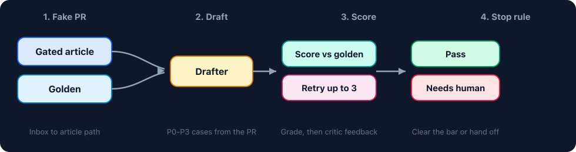

# 🔗 Magic Link Lab

A tiny dashboard that **drafts a P0–P3 test plan** from a fake PR (email login link to a gated article), **scores it against a golden**, retries with critic feedback, then **passes or escalates to a human** after 3 attempts.

## How the flow works



| Step | Color | What it is |
|------|-------|------------|
| **1 · Fake PR** | Blue | A made-up gated-article change plus the golden plan you would sign |
| **2 · Draft** | Amber | Drafter writes P0–P3 cases from the PR only (not the golden) |
| **3 · Score** | Teal / pink | Compare to the golden. Under 80%? Retry with the critic list, max 3 |
| **4 · Stop rule** | Green / red | **Pass**, or **Needs human** |

If it cannot score itself, it is not a loop.

## What problem this solves

Password login is one risk surface. A **magic link** (one-time email login) is another: the user leaves the site or the app, opens the inbox, and taps a link that should sign them in **and** open the story they wanted. Web, iOS, and Android each need their own login. There is no shared cookie. A plan that only covers the laptop is not a plan.

Until they tap, the backend may still be **pending** (token not ready). If the API fails after the email already went out, the click is a dead end.

This lab grades an agent on that path. Email + password + Remember me lives in [Loop Lab](https://github.com/ramonacraft/loop-lab). Sign in with a social provider is out of v1. In-article comments are a **sibling** risk surface (third-party embed + profile login), not the teaching PR.

## The five fake PRs

| PR | Platform | What you should see |
|----|----------|---------------------|
| **#2104 Email link to a gated article** | Web + mobile | Teaching story. Same plan covers web, iOS, and Android as **separate** logins. Attempt 1 = **50%** (misses pending + dead-link), attempt 2 = **100%**, **Pass** |
| **#2118 iOS tap in Mail after a web start** | iOS | Still under the bar after 3 tries. **Needs human** plus a brief that asks which side (API or client) |
| **#2124 Android tap after a web start** | Android | Covers the golden on attempt 1. **Pass** |
| **#2130 Private window / blocked cookies** | Web + mobile | Desktop private window and iOS Safari private browsing. Misses the honest-fail path, then **Pass** |
| **#2136 Comment embed vs app login** | Web + mobile | Different risk surface. Site and embed should agree in one browser. The app is a separate login. Misses that, then **Pass** |

Sample names and articles are fake. Nothing here is a real product, employer, or customer change.

## Quick start

**Prerequisites:** Node.js 18+

```bash
git clone https://github.com/ramonacraft/magic-link-lab.git
cd magic-link-lab
npm install
npm test
npm run dev
```

Open the URL Vite prints (usually `http://localhost:5173`).

You should see five fake PRs on the left and the gated-article teaching story selected.

## How to walk the product

1. Read [docs/PAPER_WALKTHROUGH.md](docs/PAPER_WALKTHROUGH.md) (the gated-article story on paper)
2. On PR #2104, click **Run attempt 1** — expect **50%**. Then click **Retry with critic** — expect **100% Pass**
3. Click the iOS PR. It is still a web-start then Mail-tap path. Run three times — expect **Needs human** after attempt 3, then a **Human brief** with theory, a fast confirm, and a fix path
4. Try Android — same web-start mix, **Pass** on attempt 1 (not every change needs a retry)
5. Try the comment-embed PR — expect a retry, then **Pass**. Site vs widget in one browser. The app is a separate login. It is not the magic-link teaching story

No API key. The drafter and scorer are deterministic so anyone who runs it gets the same screenshot every time.

## Stack

- Vite + React 19 + TypeScript
- Loop engine in `src/engine/` (draft, score, retry, history)
- Fake PRs and goldens in `src/data/fixtures.ts`
- Run history in this browser only (`localStorage`)

## Project layout

```text
src/
  components/   PR list, golden, attempts, verdict, history
  data/         Five fake PRs and goldens
  engine/       Drafter, scorer, loop, history
  types/        Shared types
docs/
  PAPER_WALKTHROUGH.md
  flow.png
```

## Related work

- [Loop Lab](https://github.com/ramonacraft/loop-lab) — grades the agent on email + password + Remember me
- [Weekly Risk Radar](https://github.com/ramonacraft/weekly-risk-radar) — what might break
- [Release Gate Lab](https://github.com/ramonacraft/release-gate-lab) — can we ship?
- [Live Event War Room](https://github.com/ramonacraft/live-event-war-room) — is the live window healthy?

## Notes / Privacy

- **Published by** [Ramona Bonitatis](https://github.com/ramonacraft).
- **Default: no secrets.** This app runs with an empty or commented `.env`. `.env.example` has no tokens.
- Fake PRs, goldens, and scores are local sample data. Nothing here is a real GitHub org, customer, or employer change.
- Public copy stays generic: gated article, news app, magic link. No live login URLs.
- Run history stays in your browser. It is not sent anywhere.
- See [AGENTS.md](./AGENTS.md) for contributor conventions in Cursor.
